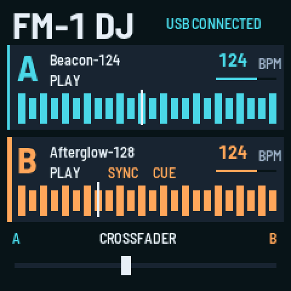
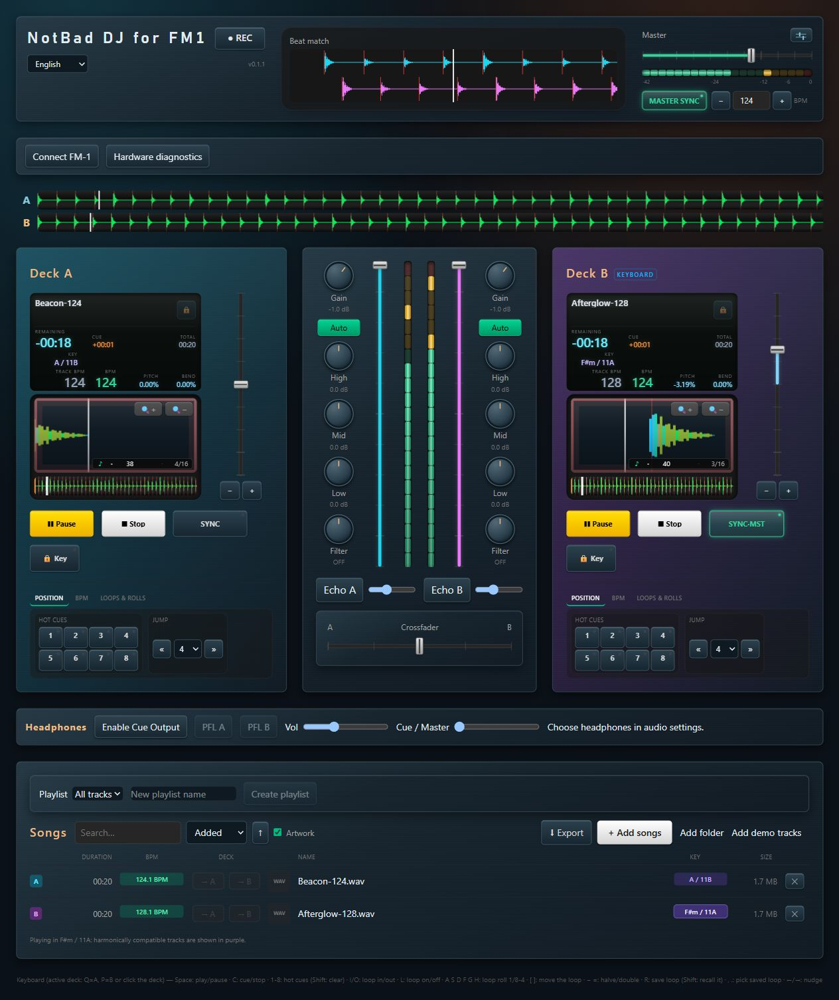
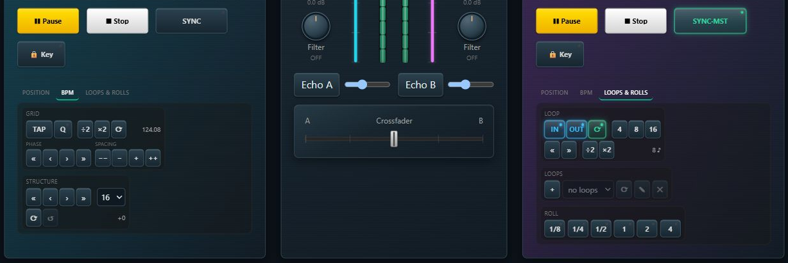
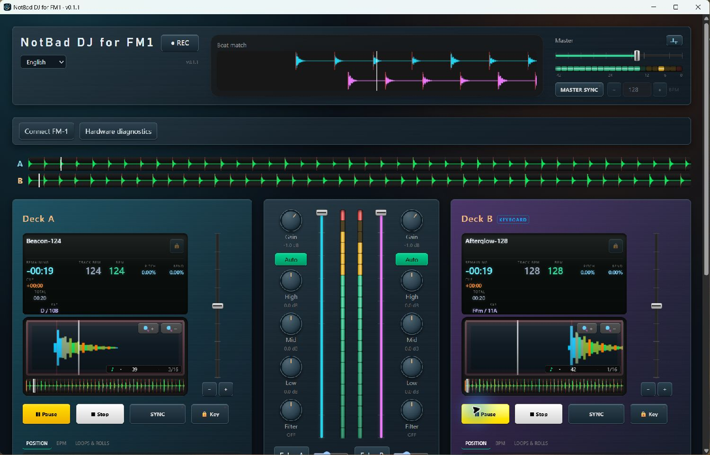
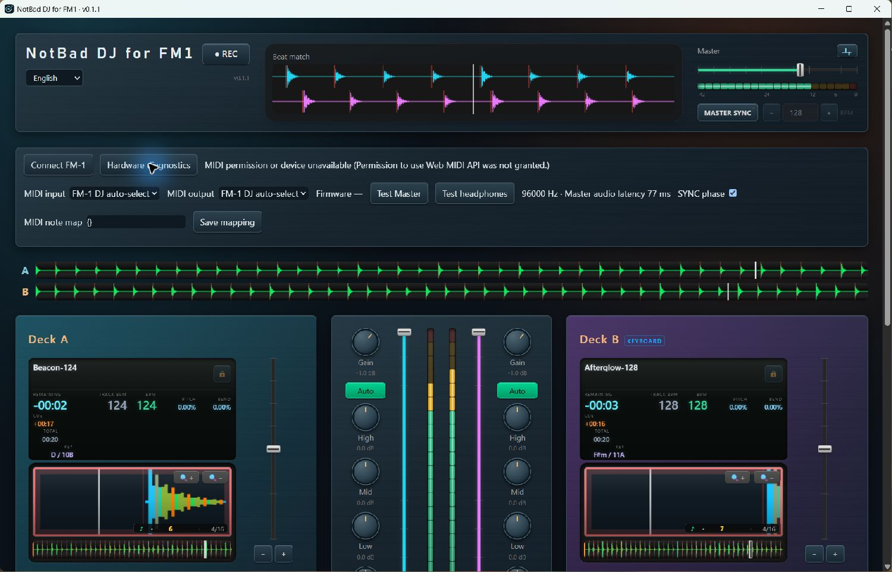
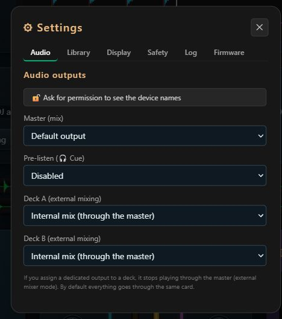

# NotBad DJ for FM1

[Русская версия](README.ru.md)

## Built around the M‑VAVE FM‑1

NotBad DJ turns the FM‑1 into a two-deck DJ controller. Use its buttons and knobs to load tracks, cue the next deck, and bring it into the mix. The FM‑1 display shows both decks, their waveforms and BPM, and the crossfader position. The browser plays and mixes local tracks, sends deck status over USB MIDI, and routes headphone cue audio to the FM‑1 over USB Audio.

*FM‑1 display captured from firmware 0.1.1 running in the emulator with the two demo tracks in a simulated mix.*

## Mixing in the browser

**Mix two tracks.** Compare both waveforms in Beat Match, match tempos with Sync, and blend the decks with channel EQ, filters, echo and the crossfader. The local library shows BPM and musical key, and **REC** captures the master mix.

**Prepare transitions.** Fine-tune the beat grid in **BPM**, jump to hot cues in **Position**, or use **Loops & rolls** to set, resize and save loops. Deck B shows an active eight-beat loop.

## Getting started

Open [NotBad DJ for FM1 on GitHub Pages](https://teutonick.github.io/NotBad-DJ-for-FM1/) in a current version of Chrome on macOS or Windows 11. For Windows MIDI and audio setup, see the [Windows checklist](docs/WINDOWS.md).

To build locally, use Node.js 24 and run `npm ci --ignore-scripts`, `npm run build`, and `npm run preview`. The **Web checks and GitHub Pages** workflow publishes `dist` from `main`.

Add local WAV, MP3 or FLAC tracks to the library and load them onto decks A and B. **Add demo tracks** imports [Beacon (124 BPM)](public/demo/Beacon-124.wav) and [Afterglow (128 BPM)](public/demo/Afterglow-128.wav), generated metronome samples released under CC0-1.0. To check phase sync, start deck A, enable Sync on B, and start B. The deck tools let you adjust each track's BPM and beat grid.

## Windows desktop app

## Master and headphone cue

**Connect the controller.** Hardware diagnostics shows the MIDI connection status, separate input and output selectors, and test controls for the master and headphone paths. The screenshot shows the panel before a MIDI connection is established.

**Route the mix and headphones separately.** Assign the speakers to Master and the FM-1 to Cue. Use PFL A or B to preview a deck in the headphones and adjust the Cue/Master blend.

1. Plug the FM-1 into USB and connect wired headphones to it. Start with the controller's MASTER level low.
2. Select **Connect FM-1** and allow MIDI with SysEx. If the browser does not select the ports automatically, choose the FM-1 MIDI input and output separately under **Hardware diagnostics**. Windows may number the ports differently.
3. In **Settings → Audio**, select your speakers or other audio interface as Master and **FM-1 DJ** as the separate Cue output. Use the permission button in that tab if the browser hides device names.
4. Select **Enable Cue Output**. Use **Test Master** and **Test headphones** in Hardware diagnostics to check routing.
5. Pan the crossfader to A, start both decks, and enable PFL B. Master should play A, and the headphones should play B. Swap sides and then test both PFL buttons and the Cue/Master blend.
6. If the FM-1 disconnects, reconnect it, verify the Cue device, and enable Cue again.

## Firmware

Release 0.1.0 is available for inspection in [Settings → Firmware](docs/FIRMWARE-SAFETY.md). The panel verifies the release package, compares two complete Flash dumps and reads the MIDI identity. Installation is blocked pending hardware validation and a recovery path tied to the connected unit.

### Build the firmware

The source is in [firmware/dj](firmware/dj). Run `firmware/build.sh --host` for the simulator. The device build uses Linux x86-64 or macOS with Docker or Podman, Python 3.12 and Pillow with Raqm. After the first host build, run `firmware/base/tools/setup_toolchain.sh --only jieli,ac79-sdk` and then `firmware/build.sh --release 0.1.1`. The installer package appears under `firmware/dj/build`. The **Firmware Safety Gate** ([docs](docs/FIRMWARE-SAFETY-GATE.md)) workflow uses the same process.

## License and disclaimer

See [Third-party licenses and credits](docs/UPSTREAM.md) for Mini DJ by Wincha, firmware, the browser installer, and other components. The web application is distributed under the [MIT License](LICENSE). The firmware source and the vendored fm1-base installer modules are [MPL-2.0](firmware/licenses/MPL-2.0.txt). Retain applicable attribution and license notices when redistributing.

NotBad DJ for FM1 is an independent project. Review the [disclaimer](DISCLAIMER.md) before using or distributing it, especially before flashing the controller.

[Control map and protocol](docs/PROTOCOL.md) · [Acceptance report](docs/ACCEPTANCE.md)
