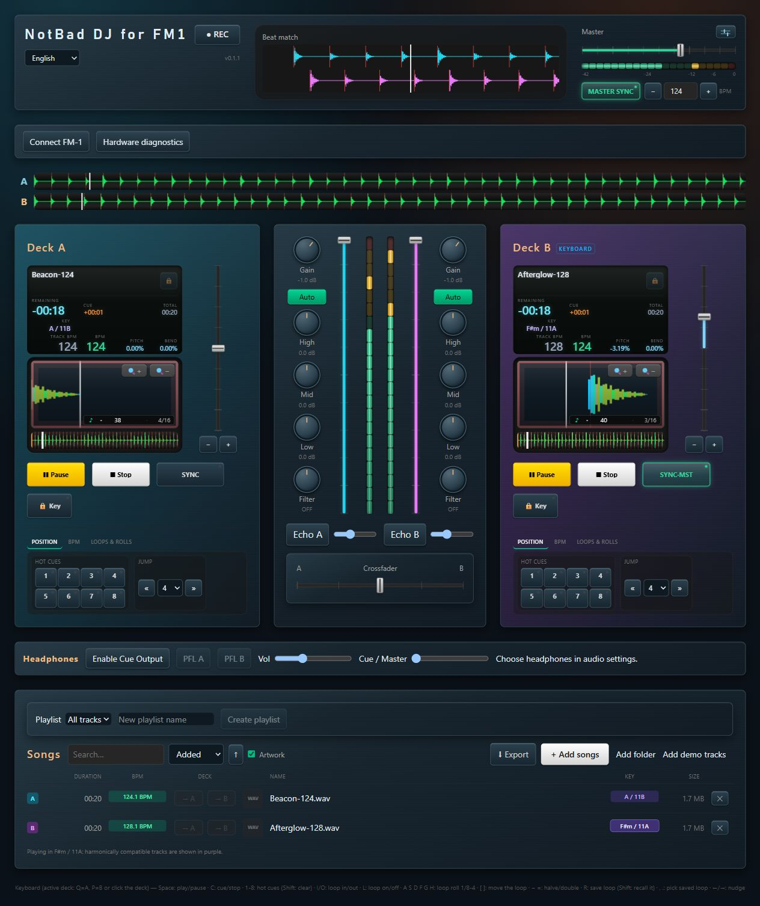
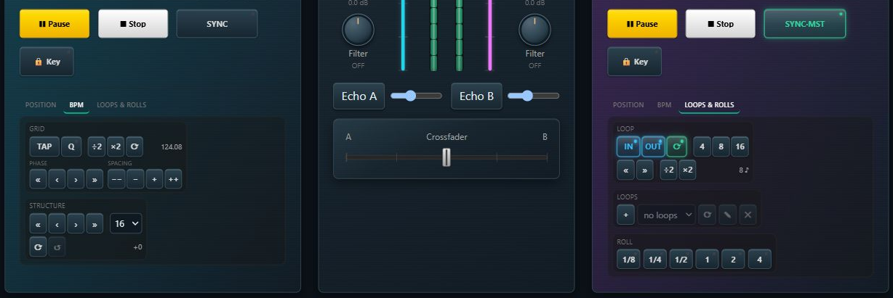
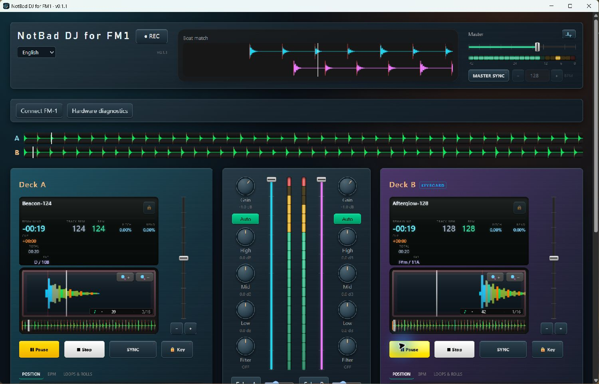
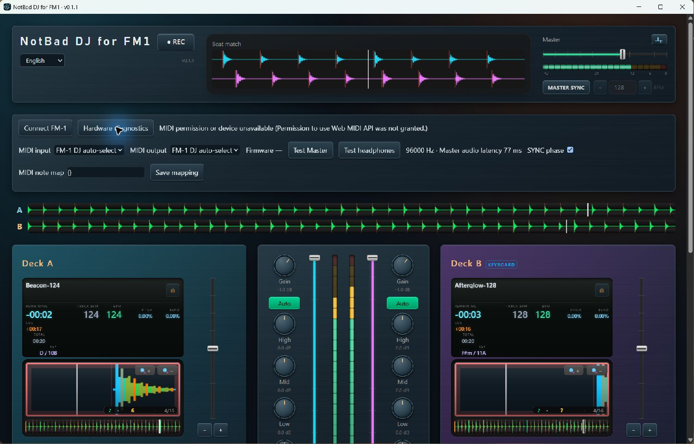
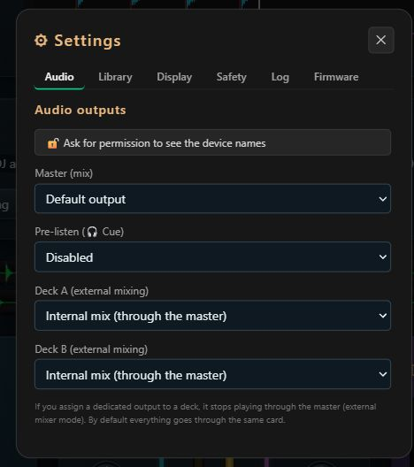

# NotBad DJ for FM1

[English](README.md)

Две браузерные деки и прошивка USB-контроллера для M-VAVE FM-1. Браузер декодирует и микширует локальные файлы. FM-1 принимает звук Cue по USB Audio и обменивается командами и состоянием по USB MIDI.

## Сведение в браузере

**Сведение двух треков.** Сравнивайте волны в **Beat Match**, выравнивайте темп через **Sync** и сводите деки с помощью эквалайзера, фильтра, эха и кроссфейдера. Библиотека показывает BPM и тональность, а **REC** записывает общий микс.

**Подготовка переходов.** Настраивайте сетку во вкладке **BPM**, переходите к меткам во вкладке **Position**, создавайте, меняйте и сохраняйте петли в **Loops & rolls**. На деке B активна петля на восемь долей.

## Запуск

Откройте [NotBad DJ for FM1 на GitHub Pages](https://teutonick.github.io/NotBad-DJ-for-FM1/) в актуальном Google Chrome на macOS или Windows 11. Для работы сайта локальный сервер, Python и Node.js не требуются. Полный сценарий с FM-1 на Windows ещё предстоит проверить по [чек-листу Windows](docs/WINDOWS.md).

Для локальной сборки выполните `npm ci --ignore-scripts`, затем `npm run build` и `npm run preview`. Workflow **Web checks and GitHub Pages** публикует `dist` из ветки `main`.

В библиотеке добавьте WAV, MP3 или FLAC, затем загрузите треки на A и B. Кнопка **Add demo tracks** импортирует два встроенных тестовых файла. [Beacon, 124 BPM](public/demo/Beacon-124.wav) и [Afterglow, 128 BPM](public/demo/Afterglow-128.wav) — сгенерированные метрономные фрагменты, CC0-1.0. Для проверки фазового Sync включите A, нажмите Sync на B и запустите B. В инструментах деки можно исправить BPM и положение сетки.

## Настольное приложение для Windows

## Master и Cue

**Подключение контроллера.** В **Hardware diagnostics** виден статус MIDI. Здесь можно отдельно выбрать вход и выход и проверить сигнал на Master и в наушниках. На снимке панель показана до подключения по MIDI.

**Раздельные выходы.** Направьте общий микс на Master, а сигнал для наушников на FM-1 через Cue. Кнопки PFL A и B выбирают деку для предпрослушивания, а ручка Cue/Master регулирует долю общего микса в наушниках.

1. Выберите динамики компьютера или внешний выход как Master. Подключите FM-1 по USB и вставьте проводные наушники в FM-1. Начните с малой громкости MASTER на корпусе.
2. Нажмите **Connect FM-1**, разрешите MIDI с SysEx. Дождитесь **MIDI connected**. Если автоматический выбор не сработал, откройте **Hardware diagnostics** и отдельно выберите **MIDI input** и **MIDI output** FM-1. Номера портов Windows могут различаться. Приложение покажет версию прошивки после её ответа.
3. В настройках **Audio** выберите Master и отдельный Cue **FM-1 DJ**. Если Chrome скрывает имена, запросите разрешение на доступ к аудиоустройствам в этой вкладке. Приложение сразу освобождает полученный аудиовход. Если маршрутизация отклонена, явно выберите динамики компьютера в Master вместо системного значения по умолчанию.
4. Нажмите **Enable Cue Output**. В Hardware diagnostics отдельно проверьте **Test Master** и **Test headphones**.
5. Установите Crossfader в A. Запустите обе деки и включите PFL B. В Master должен остаться A, а в наушниках должен появиться B. Повторите зеркально, затем включите оба PFL и проверьте Cue/Master.
6. Если FM-1 отключился, приложение заглушает Cue при обновлении списка аудиоустройств. После подключения дождитесь **MIDI connected**, проверьте название выхода и снова включите Cue.

## Прошивка

В **Настройки → Прошивка** можно проверить пакет релиза 0.1.0, сравнить два полных дампа Flash и прочитать идентификатор MIDI. Запись заблокирована до аппаратной проверки и подтверждения способа восстановления для подключённого устройства. Подготовка полного бэкапа и действия при сбое описаны в [руководстве по безопасности прошивки](docs/FIRMWARE-SAFETY.md).

### Сборка прошивки

Исходники находятся в [firmware/dj](firmware/dj). `firmware/build.sh --host` собирает симулятор. Для сборки пакета используйте Linux x86-64 или macOS с Docker или Podman, Python 3.12 и Pillow с Raqm. После первой host-сборки выполните `firmware/base/tools/setup_toolchain.sh --only jieli,ac79-sdk`, затем `firmware/build.sh --release 0.1.1`. Пакет сохраняется в `firmware/dj/build`. Те же шаги выполняет workflow **Firmware Safety Gate** ([docs](docs/FIRMWARE-SAFETY-GATE.md)).

## Лицензия и отказ от ответственности

Веб-приложение распространяется под [MIT](LICENSE). Для отдельных компонентов действуют [их собственные лицензии](docs/UPSTREAM.md). Исходники прошивки и модули браузерного установщика fm1-base распространяются под [MPL-2.0](firmware/licenses/MPL-2.0.txt).

Перед использованием и особенно перед записью прошивки прочитайте [отказ от ответственности](DISCLAIMER.md#отказ-от-ответственности).
